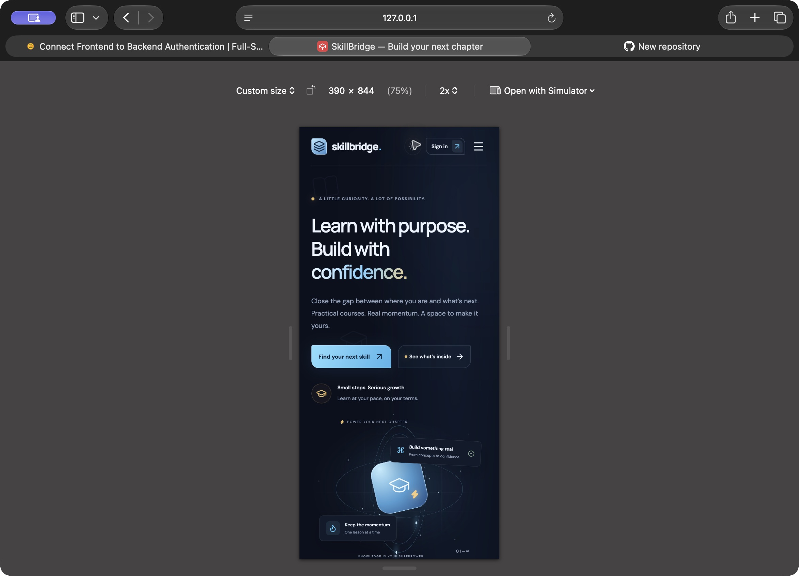
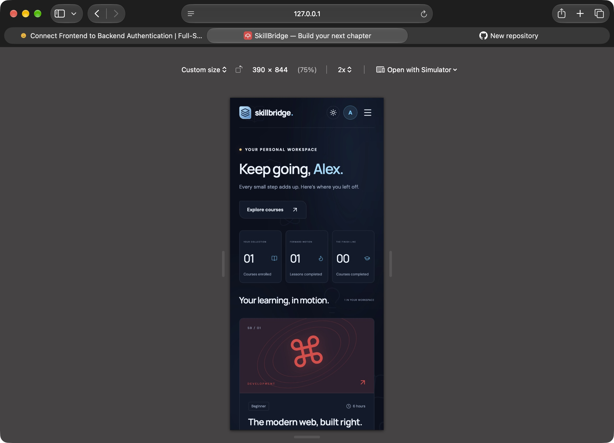

<div align="center">


**A focused learning platform for the skills that move you forward.**

[Explore SkillBridge](https://skillbridge-learning-studio.heartyvole32.chatgpt.site) · [Local setup](#run-locally) · [API](#api-reference) · [Verification](#verification)


</div>

## What it does

SkillBridge connects a responsive React interface to a real API and durable relational database. Learners create an account, explore six courses, enroll, work through guided lessons, save notes and track completion in a personal workspace. Refreshing the browser or signing in again restores the saved learning record.

The interface uses a midnight-blue thunderstorm palette, electric-cyan controls, gold highlights, orbital motion, lightning and drifting education symbols. Dawn mode provides a bright alternative. Both themes respect reduced-motion preferences.

## Features

| Area | Included |
| --- | --- |
| Accounts | Registration, login, logout, display-name editing and persistent sessions |
| Authentication | Signed HS256 JWTs, HttpOnly cookies, in-memory bearer tokens and Axios authorization interceptors |
| Course discovery | Six curated courses, category filters, keyword search and empty states |
| Learning | 23 text lessons with practical exercises and a responsive lesson reader |
| Personal workspace | Enrolled courses, lesson counts, course completion and progress bars |
| Progress | Mark complete, undo completion and resume saved progress |
| Notes | Private notes per course, saved to the database |
| Interface | Mobile navigation, light/dark themes, click ripples, focus indicators and motion preferences |
| Data protection | Server authorization, account-scoped queries, input validation, origin checks and login attempt limits |

Course durations are estimated practice times. The lessons are text-based learning material; there are no paid subscriptions, video hosting, accreditation or certificates. Course content is maintained in source rather than through an admin panel.

## Technology

| Layer | Technology |
| --- | --- |
| Interface | React 19, TypeScript, Lucide icons, custom CSS and Tailwind’s base stylesheet |
| Application runtime | Vinext with Vite and Next-compatible route handlers |
| API client | Axios with request and response interceptors |
| Database | Cloudflare D1 (SQLite), Drizzle ORM and versioned SQL migrations |
| Server | Cloudflare Workers with Web Crypto |
| Authentication | PBKDF2-SHA256 password hashes, random salts, HS256 JWTs and revocable sessions |

Frontend assets and backend endpoints share one origin. There is no separate backend URL to configure and no permissive cross-origin setup.

## Run locally

Requires **Node.js 22.13+** and npm. Node.js 24 is recommended.

```bash
git clone https://github.com/rachit1807/skillbridge.git
cd skillbridge
npm ci
npm run build
```

Initialize the local database once, applying migrations in order:

```bash
node --import ./scripts/sites-env.mjs ./node_modules/wrangler/bin/wrangler.js d1 execute DB --local --config dist/server/wrangler.json --persist-to .wrangler/state --file drizzle/0000_sticky_solo.sql
node --import ./scripts/sites-env.mjs ./node_modules/wrangler/bin/wrangler.js d1 execute DB --local --config dist/server/wrangler.json --persist-to .wrangler/state --file drizzle/0001_elite_bloodscream.sql
npm run start
```

Open **http://127.0.0.1:8787**. Create your own account using the sign-in dialog. No shared demo credentials are installed in production.

For development with hot reload, use `npm run dev` after local setup. After a production build, restart `npm run start` to ensure it loads the latest server modules. Local database files live in `.wrangler/state` and are ignored by Git. Local and deployed databases are separate.

On restricted macOS environments, use a writable tool configuration directory and polling:

```bash
XDG_CONFIG_HOME=/private/tmp/skillbridge-config WRANGLER_SEND_METRICS=false CHOKIDAR_USEPOLLING=true npm run start
```

If npm reports a shared-cache ownership error, use `npm_config_cache=/private/tmp/skillbridge-npm-cache npm ci`.

## Frontend ↔ backend connection

1. `lib/axiosClient.ts` creates an Axios instance with `/api/` as its base URL.
2. Signup or login posts credentials to the authentication API.
3. The server validates input, verifies a salted password hash and creates a revocable session. It signs a JWT with a separate, random signing key for that session.
4. The JWT is sent as an HttpOnly, SameSite=Lax cookie and returned for in-memory use. Production HTTPS cookies are marked Secure.
5. The request interceptor attaches the current JWT as `Authorization: Bearer …`. Tokens are never placed in localStorage or sessionStorage.
6. `AuthContext` exposes the current user. `ProtectedRoute` guards the workspace interface. Every private API independently verifies the JWT and scopes database operations to the authenticated user.
7. On refresh, `/api/auth/me` restores the user and in-memory token from the cookie. Sessions expire after seven days. A protected request returning 401 clears client state and opens sign-in again.
8. Logout deletes the server session, clears the cookie and removes client account data. Reusing that JWT then returns 401.

The theme is the only preference stored in localStorage. Authentication state and learning records are not stored there.

## API reference

All request bodies and responses use JSON. Private endpoints require the session cookie or a valid bearer JWT.

| Method | Endpoint | Purpose |
| --- | --- | --- |
| POST | `/api/auth/register` | Create an account with `name`, `email`, `password` |
| POST | `/api/auth/login` | Sign in with `email`, `password` |
| GET | `/api/auth/me` | Restore the authenticated account |
| POST | `/api/auth/logout` | Revoke the current session |
| GET | `/api/courses` | Read the course collection |
| GET | `/api/enrollments` | Read the current user’s enrollments |
| POST | `/api/enrollments` | Enroll with `courseId` |
| PATCH | `/api/enrollments` | Update `completed` lesson indices and/or `notes` for `courseId` |
| PATCH | `/api/profile` | Update the current user’s `name` |

Errors use `{ "error": "A readable explanation" }`. Invalid inputs return 400, unauthenticated requests 401, unauthorized updates 403, missing courses 404 and duplicate emails 409. More than 12 authentication attempts per email and operation within 15 minutes returns 429.

## Project structure

```text
app/
  page.tsx                  Interactive learning experience
  globals.css               Responsive storm and dawn themes
  layout.tsx                Document metadata and layout
  api/[...path]/route.ts    Authentication and learning API
components/
  AuthContext.tsx           Shared account state
  ProtectedRoute.tsx        Workspace UI access guard
lib/
  axiosClient.ts            API client and session interceptors
  courses.ts                Course and lesson content
  ...                       Runtime integration helpers
db/
  schema.ts                 Users, sessions, enrollments and attempt limits
  index.ts                  D1 database connection
drizzle/                    Versioned SQL migrations
public/                     Application icon
docs/                       Screenshots and walkthrough
tests/api.test.mjs          Backend integration checks
scripts/                    Build and hosting support
.openai/hosting.json         Deployment identity and DB binding
```

## Verification

```bash
npm run typecheck
npm run build
# With the local server running:
npm run test:api
```

The integration checks exercise invalid registration, duplicate accounts, incorrect passwords, JWT tampering, unauthenticated access, duplicate enrollment, invalid progress, note persistence, profile updates, cross-account isolation, login persistence and logout revocation. The test uses synthetic accounts in the local database. Run against a disposable local environment.

Safari was used for desktop and 390px mobile visual checks, theme switching, sign-in, enrollment, completion and the mobile menu. See the [manual walkthrough](docs/WALKTHROUGH.md) for reproduction steps and cookie inspection without exposing tokens.

## Screenshots

### Mobile · storm mode


### Personal workspace


## Deployment

The application is packaged as a Cloudflare Worker with static assets and a D1 binding named `DB`. The tracked hosting manifest declares the project and binding; deployment tooling provisions the database and applies committed migrations before activating the Worker. Build output, local databases, credentials and tool state are excluded from Git.

When self-hosting outside the configured deployment, create a D1 database, bind it as `DB`, apply the SQL files in `drizzle/` in order, then deploy the Worker and built client assets. Keep production traffic behind HTTPS. The configured hosting service may apply an additional site-access sign-in boundary independently of the application’s learner accounts.

Password reset and email verification require a transactional email provider and are not included. There is no admin role, payment system or user-uploaded course content.

---

Built and maintained by [Rachit Tripathi](https://github.com/rachit1807).
